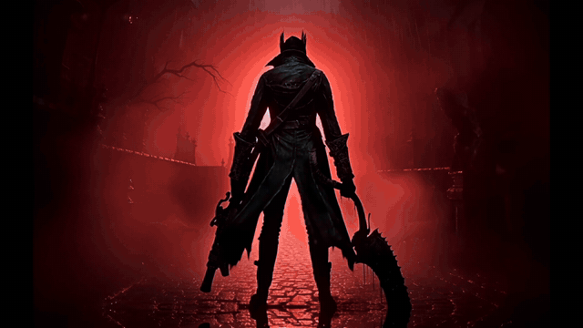

# Bloodborne Animated Title

Replaces Bloodborne's static title screen with a 1080p animated cinematic.

[](https://youtu.be/8yH97IGCA3w)

▶ **[Watch on YouTube](https://youtu.be/8yH97IGCA3w)** · [download the 1080p 30 fps preview](media/preview_1080p30.mp4)

The title screen opens on the Hunter under a blood moon. Lightning flashes, the red light fades into
the cold Yharnam night, and blood and ash gather into the Bloodborne logo. The 10-second clip plays once
and then holds on the classic title screen. The ™ mark appears once the logo has formed. Then the menu
(Play Online / Play Offline), its cursor and the copyright line fade in over one second.

## Install

1. Download `bloodborne-animated-title-v1.0.2.zip` from [Releases](../../releases/latest).
2. Extract it. You get four files under `bloodborne-animated-title\dvdroot_ps4\menu\`:
   `title.tpf.dcx`, `title.gfx`, `title_dlc.gfx`, `title_dlc_eu.gfx`.
3. Install them in one of two ways:
   - **With mod-folder support:** put the `bloodborne-animated-title` folder in your mods folder.
   - **Without it:** back up the same four files in the game's `dvdroot_ps4\menu\` folder, then overwrite them.
4. Start the game.

To uninstall, delete the mod folder, or restore the backed-up files.

**Notes**
- The prebuilt files come from **CUSA03173 (EU) v1.09**. For another region or version, build from your own dump (see below).
- The flipbook holds about 300 MB of textures (301 frames, 1920×1088 BC1). If your setup struggles, build a 720p version with `--size 1280x736` (about 135 MB).
- Don't keep other mods that replace `menu/title*.gfx` or `menu/title.tpf.dcx` enabled at the same time.

## How it was made

This is a pure file mod: it needs no engine or port changes and no ActionScript.

1. **File formats.** Python readers and writers for the game's formats:
   - DCX (DFLT/zlib) containers
   - TPF texture packs: PS4 tiled BC1/BC7, with a numpy swizzle and BC1 encoder
   - Scaleform GFX (SWF v11) tag streams

   Unmodified TPF and GFX files rebuild byte-for-byte.
2. **Where the title lives.** The background is a bitmap shape (`MENU_Title_00001`) inside `title.gfx`, `title_dlc.gfx` and `title_dlc_eu.gfx`. The EU build actually boots `title_dlc_eu.gfx`, so all three are patched.
3. **Video.** A 10-second 1080p clip was generated with **Vidu Q4** image-to-video (through fal.ai), using the original title art as the first frame. The prompt is in [`fal_q4_final.json`](fal_q4_final.json): the logo bleeds and crumbles into blood ash, lightning strikes, and a blood moon rises.
4. **Edit.**
   - The clip is played **in reverse**, so it ends exactly on the original title image.
   - The red of the dissolving logo is slightly desaturated.
   - The clip is motion-interpolated from 24 to 30 fps (ffmpeg `minterpolate`) so every frame of the 30 fps GFX timeline shows a new image, with no 3:2 judder.
5. **Flipbook.**
   - Each frame is BC1-encoded, PS4-swizzled and appended to `title.tpf` as `MENU_TitleI_####`.
   - The GFX gets one `DefineExternalImage2` plus a bitmap shape per frame, and a single sprite that swaps the shape every timeline frame.
   - That sprite replaces the original background shape and holds on the last frame.

6. **™ mark.** The ™ text field (`StaticRegionText_401100`) starts off-stage. On the final frame its sprite moves the *same instance* back into place. The game fills the localized text into that field only once, at load, so placing a fresh copy later would show its placeholder text ("TradeMark").
7. **Menu fade-in.** Some objects start with an alpha-0 colour transform, and their one-frame sprites get a timeline that ramps alpha to full over the last second:
   - the menu-item plate and label
   - the cursor graphic, inside its blink animation
   - the copyright line

Lessons learned:
- A *nested* self-looping sprite (an intro followed by a loop clip) did not animate in-game. A single flat sprite timeline works.
- The game drives `CommandList`, `Item_*` and `Cursor` from code. Once code touches an object, Scaleform ignores timeline moves on it, so fading those directly leaves the menu invisible. The fades therefore target the children inside them.

## Build it yourself

Requires [uv](https://docs.astral.sh/uv/). It installs Python, numpy, Pillow and ffmpeg on the fly.

```powershell
# point to the game's original (unmodified) menu folder
$env:BB_MENU = "<game folder>\dvdroot_ps4\menu"

# get the source clip: download q4_bloodmoon_1080p24.mp4 from Releases into vidu\q4_final_bloodmoon_1080.mp4
# (or generate your own, see below)

uv run make_reverse.py --clip vidu/q4_final_bloodmoon_1080.mp4 --name animated_title --size 1920x1088 --red-desat 0.35
powershell -ExecutionPolicy Bypass -File install.ps1 animated_title -Mods "<your mods folder>"
```

Building takes a few minutes, mostly for motion interpolation and BC1 encoding. `build/animated_title/preview_30fps.mp4` shows exactly what will play.

### Generate a new clip

```powershell
uv run vidu.py ref-image                     # writes vidu/ref_title.png (1920x1080) from your dump
$env:FAL_KEY = "<your fal.ai key>"
uv run fal.py submit fal_q4_final.json       # edit the prompt / duration / seed first
uv run fal.py poll                           # downloads vidu/<name>.mp4
```

## Files

| File | Purpose |
|---|---|
| `bbfmt.py` | DCX read/write, TPF parse/build, PS4 swizzle |
| `bc1.py` | numpy BC1 encoder/decoder |
| `gfx.py` | Scaleform GFX tag parser/writer, shapes, flipbook sprites |
| `video_tools.py` | ffmpeg decode, motion-interpolated retime, mp4 preview |
| `make_reverse.py` | **main builder**: clip → reversed 30 fps flipbook mod |
| `make_intro_loop.py`, `make_poc.py` | GFX patching helpers and the original proof-of-concept builds |
| `vidu.py`, `fal.py` | Vidu / fal.ai API clients (keys from `.vidu_key` / `.fal_key` or env vars) |
| `sheet.py` | contact sheet + cut detection for generated clips |
| `install.ps1` | copies a build into `<mods>\bloodborne-animated-title` |

## Credits

- Bloodborne © Sony Interactive Entertainment / FromSoftware. This is an unofficial fan project, not affiliated with or endorsed by them.
- The video was generated with Vidu Q4 from the game's original title art.
- Source code: MIT (see [LICENSE](LICENSE)).
